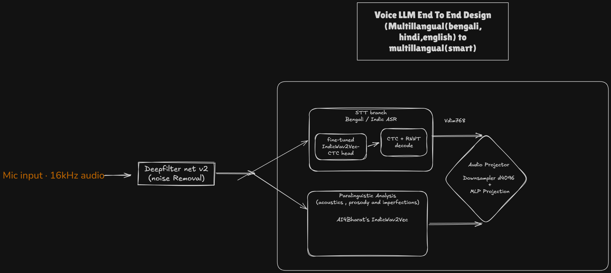

# 🎙️ Samvyas

<p align="center">
  
</p>

**Samvyas** is a modern research and development repository for Multimodal Voice & Audio Intelligence.

---

## 📁 Repository Overview

```
Samvyas/
├── assets/                     # Audio samples & media assets
│   └── audio/
├── configs/                    # Configuration files
├── notebooks/                  # Interactive experimentation & validation notebooks
│   └── indic_conformer_test.ipynb
├── public/                     # Architectural assets
│   └── stt.png
├── tests/                      # Testing harnesses
├── pyproject.toml              # Build configuration
├── requirements.txt            # Dependencies
└── README.md
```

---

## 🚀 Quickstart

```bash
# Install dependencies (use the project .venv on Windows)
.\.venv\Scripts\python.exe -m pip install -r requirements.txt

# Install the samvyas package editable (needed for scripts/)
.\.venv\Scripts\python.exe -m pip install -e . --no-deps

# Fetch model weights once (cached outside the repo)
.\.venv\Scripts\python.exe scripts/download_models.py

# Live mic demo: 5s clips from default mic, loop till Ctrl+C
# (STT transcript + 768-vector/PCA + paralinguistic acoustics/prosody)
.\.venv\Scripts\python.exe scripts/live_stt.py

# Mic-less dry run on a sample file
.\.venv\Scripts\python.exe scripts/live_stt.py --file assets/audio/vocaltest.m4a --no-denoise

# Run tests (SAMVYAS_RUN_HEAVY=1 enables real-model GPU tests)
.\.venv\Scripts\python.exe -m pytest tests/ -q
```

## Bengali voice collection

The recorder needs no models or GPU. From the project folder, use its separate
environment (already created on this machine):

```powershell
.\.venv-recorder\Scripts\python.exe scripts/record_voice.py --list-devices
.\.venv-recorder\Scripts\python.exe scripts/record_voice.py
# Optional: choose a microphone by its listed index
.\.venv-recorder\Scripts\python.exe scripts/record_voice.py --device 1
```

To create that environment on another machine with Python 3.11 and uv:

```powershell
uv venv --python 3.11 .venv-recorder
uv pip install --python .venv-recorder/Scripts/python.exe -r requirements-recorder.txt
```

The recorder configures the Windows console for UTF-8 and writes Bengali
prompts through its native Unicode API. This fixes legacy PowerShell and
Command Prompt code-page corruption. Use Windows Terminal, PowerShell, or the
VS Code terminal with a Bengali-capable font; a missing Bengali font still
needs to be fixed in the terminal's font settings.

The three-second microphone check is played back and discarded. Every choice
is one letter: type **r** to record or **q** to quit; after the check, type
**y** to continue or **n** to repeat. For each prompt, type **r** to record,
then press Enter to stop (or wait for the 20-second limit). Review with **y**
(save/confirm displayed transcript), **n** (record again), **p** (play),
**e** (edit transcript), **s** (skip), or **q** (quit). If you depart from the
prompt, edit the transcript before pressing **y**. Suggested delivery is
guidance, not a measured emotion label. Keep microphone distance/gain
consistent; retry noisy or clipped takes.

Accepted files go to `assets/audio/voice_dataset/wavs/`; UTF-8
`manifest.jsonl` stores their transcripts and measurements. Each save prints
the clip ID, accepted count, and total duration. Restart the same command to
resume: accepted prompts are skipped; skipped prompts return next session.
Retries and unaccepted takes are discarded. Use one recorder process per
dataset folder. Orphan files from interrupted saves are reported, never
automatically deleted. Datasets and generated TTS audio are Git-ignored.

Options `--output-dir` and `--prompts` support another collection folder and
a custom UTF-8 JSON prompt file. Its format matches
[`configs/tts/bengali_prompts.json`](configs/tts/bengali_prompts.json):

```json
[{"id": "my001", "text": "আমি বাংলায় কথা বলছি।", "delivery": "স্বাভাবিক"}]
```

IDs must be unique nonempty strings. Keep IDs/text stable when resuming;
use new IDs for new sentences. Accepted manifest entries contain `clip_id`,
relative `audio_path`, `transcript`, `prompt_id`, `prompt_text`, `delivery`,
`duration` (seconds), `sample_rate`, and `quality` (peak, RMS, clipping fraction,
warnings). Audio is unprocessed mono 16 kHz PCM-16 WAV. Start with this
50-clip pilot; 30–60 usable minutes is a later fine-tuning collection target,
not a guaranteed quality threshold.

## Browser voice recorder

For a quick visual recorder, install the recorder dependencies (including
SciPy for safe browser-audio resampling) and start the local page:

```powershell
uv pip install --python .venv-recorder/Scripts/python.exe -r requirements-recorder.txt
.\.venv-recorder\Scripts\python.exe scripts/voice_recorder_web.py
```

It opens `http://127.0.0.1:8765` and is deliberately bound to this computer
only. Enter a person’s name to create or resume
`assets/audio/voice_users/<name>/`, then use **Record**, **Stop**, **Play
take**, **Record again**, and **Save sample**. The browser captures the take;
the local server downmixes and resamples it to mono 16 kHz PCM WAV before it
is accepted into that person’s `wavs/` and `manifest.jsonl`. This preserves
the original microphone level and keeps each user’s dataset separate.

Use current Chrome or Edge: the page captures microphone frames with
`AudioWorklet`, requests the best available 48 kHz mono input, and shows the
actual capture rate while recording. If a browser cannot run `AudioWorklet`,
the page reports that it is using a compatible lossless capture path. If the
shown rate is below 44.1 kHz, choose a different microphone before saving a
training-quality take.

Use `--port`, `--data-root`, or `--prompts` when another local folder, port,
or prompt list is needed. The server accepts only loopback hosts. Stop it with
`Ctrl+C` after collection.

## IndicF5 voice baseline

Jeet fine-tuning is available in
[`notebooks/jeet_indic_f5_finetune.ipynb`](notebooks/jeet_indic_f5_finetune.ipynb).
The CLI-submitted private notebook is
`https://www.kaggle.com/code/jeet065/jeet-indicf5-fine-tune`.
Its metadata attaches `jeet065/jeet-voice` and a hosted IndicF5 model copy.
The notebook requires checkpoint/vocabulary SHA-256 matches against the pinned
originals before training, embeds current tested code, and creates a Python 3.11
TTS environment under `/tmp` to avoid Kaggle's Python 3.13 package incompatibility.
This submitted workflow needs no Hugging Face token in notebook source.

Check execution with the authenticated CLI environment:

```powershell
.\.venv-kaggle\Scripts\kaggle.exe kernels status jeet065/jeet-indicf5-fine-tune
.\.venv-kaggle\Scripts\kaggle.exe kernels logs jeet065/jeet-indicf5-fine-tune --follow
```

The prepared private upload bundle is `outputs/tts/jeet_kaggle_bundle.zip`.
Upload it as a private Kaggle dataset, attach it to the notebook, enable a GPU
and Internet, and add `HF_TOKEN` through Kaggle Secrets. The notebook installs
the pinned TTS dependencies, trains, exports weights, and generates base versus
adapted listening comparisons. The token is never bundled with the dataset.

The first adaptation experiment uses 45 training clips and 5 held-out clips,
the final two DiT blocks plus output layers, batch one with accumulation four,
learning rate `1e-5`, and at most 40 epochs with early stopping after five
epochs without validation improvement. This is an experimental configuration
for six minutes of speech, not an established quality guarantee. Source audio
stays at 16 kHz and is resampled to IndicF5's native 24 kHz at the model boundary.
The pinned Bengali vocabulary is preserved. `best.safetensors` is chosen by
fixed-randomness held-out flow loss; if no training epoch beats the base loss,
it retains base weights. `last.safetensors` holds final online weights. Neither
file contains optimizer state for resuming a run.

To prepare a fresh bundle dataset or run training directly in a suitable GPU
environment:

```powershell
.\.venv-verify\Scripts\python.exe scripts/prepare_tts_adaptation.py --dataset assets/audio/voice_users/jeet --output-dir outputs/tts/jeet_adaptation_new/dataset
.\.venv-tts\Scripts\python.exe scripts/train_indic_f5.py --data-root outputs/tts/jeet_adaptation_new/dataset --output-dir outputs/tts/jeet_adaptation_new/checkpoints
```

After downloading the trained checkpoint, use it with the existing generator:

```powershell
.\.venv-tts\Scripts\python.exe scripts/test_indic_f5.py --checkpoint PATH_TO_best.safetensors --dataset assets/audio/voice_users/jeet --clip-id e2b80c70c62d48d99f6bfec0e9b8df07 --cpu-fallback --output-dir outputs/tts/jeet_adapted_preview
```

Training on Kaggle has not yet been executed. It still uses a verified reference
at synthesis time. Compare intelligibility, voice likeness, rhythm, and artifacts
against the base model before choosing the adapted checkpoint.

This baseline uses **target text + your reference audio + its verified words**.
It does not train a speaker model or accept our acoustic/prosody vectors.
The [official IndicF5 interface](https://github.com/AI4Bharat/IndicF5) uses
reference conditioning. Our wrapper loads the pinned checkpoint and its
vocabulary explicitly through AI4Bharat's F5 modules to control device
placement and freeze both transformer and vocoder.

Install TTS into its own environment, never into the working STT environment:

```powershell
uv venv --python 3.11 .venv-tts
# CUDA 12.1 PyTorch wheels for the RTX 2050
uv pip install --python .venv-tts/Scripts/python.exe torch==2.5.1 torchaudio==2.5.1 --index-url https://download.pytorch.org/whl/cu121
uv pip install --python .venv-tts/Scripts/python.exe -r requirements-tts.txt
```

For CPU-only use, replace `cu121` with `cpu` in the PyTorch install command.
Model weights stay in the Hugging Face cache outside the repository. Accept
the access conditions at [ai4bharat/IndicF5](https://huggingface.co/ai4bharat/IndicF5)
and configure `HF_TOKEN` in your environment or ignored `.env`. The existing
`HF_ACESS_TOKEN` spelling is also supported; tokens are not printed.

Select a clear **1–15 second** accepted reference. Copy its printed clip ID
or inspect the manifest; references are never silently truncated. Takes
longer than 15 seconds are preserved in the dataset but cannot serve as
baseline references. Run all three unseen Bengali sentences:

```powershell
.\.venv-tts\Scripts\python.exe scripts/test_indic_f5.py --clip-id YOUR_CLIP_ID --cpu-fallback
# Or generate your own text
.\.venv-tts\Scripts\python.exe scripts/test_indic_f5.py --clip-id YOUR_CLIP_ID --text "আজ তোমার সঙ্গে কথা বলতে ভালো লাগছে।" --device cpu
```

For another dataset, add `--dataset PATH`. For an explicitly verified external
pair, use `--reference PATH.wav --reference-text-file transcript.txt` instead
of `--clip-id`. The WAV must be mono 16 kHz; the transcript file is UTF-8.

Each run saves 24 kHz native and 16 kHz resampled WAVs plus `run.json` under
`outputs/tts/`. Choose `--output-dir` to use a new or empty folder. Existing
outputs are never overwritten. `--cpu-fallback` explicitly enables retrying
CUDA OOM on CPU; CPU inference may be slow. Both models run frozen, with
BF16 mixed precision on supported CUDA GPUs (otherwise float32). Vocos
waveform decoding always uses float32 to avoid invalid half-precision audio.
If either output exceeds the allowed amplitude,
the wrapper applies the same peak attenuation to both exports and records
`peak_scale`; collected microphone audio is never normalized.

Listen for Bengali pronunciation, resemblance to your voice, delivery, and
artifacts. Successful generation establishes neither voice similarity nor
fine-tuning readiness. A real synthesis run and listening review are required
to assess the reference-conditioned voice.

Fast tests require pytest, NumPy, SciPy, soundfile, python-dotenv, and CPU
PyTorch for the frozen-module check:

```powershell
.\.venv-verify\Scripts\python.exe -m pytest tests/test_voice_dataset.py tests/test_voice_recording.py tests/test_indic_f5.py -q
```

An optional real-model smoke test is gated by `SAMVYAS_RUN_TTS_REAL=1`,
`SAMVYAS_TTS_REFERENCE` (path), and `SAMVYAS_TTS_REFERENCE_TEXT` (verified
words). Run it in `.venv-tts` after installing pytest. `SAMVYAS_TTS_DEVICE`
defaults to `cpu`. It checks finite audio/output shapes; listening remains
the voice-quality acceptance test.
